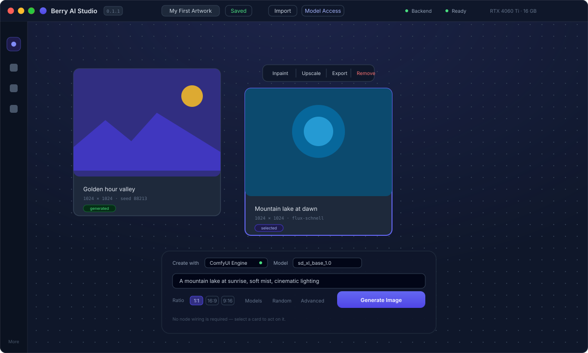
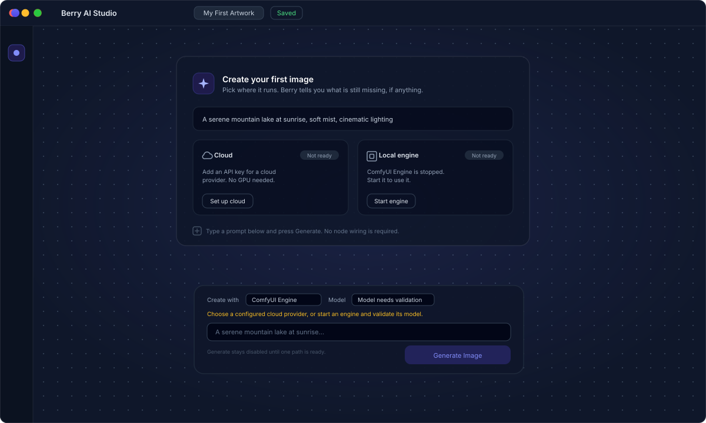
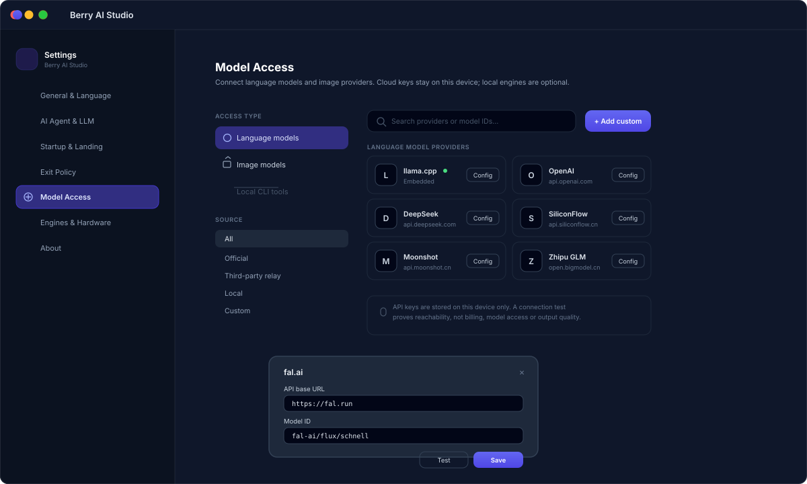

<div align="center">

# Berry AI Studio

**A creative workspace where the image workflow needs no node wiring.**

Place an image, select it, and act. Generation, inpainting, upscaling and
export stay one click away, whether they run on your GPU or in the cloud.

[](https://github.com/BerryUIKI/AI-Studio/actions/workflows/ci.yml)
[](LICENSE)


</div>

<p align="center">
  
</p>

---

## Why another AI canvas?

Node graphs are powerful and exhausting. Berry keeps the power underneath and
puts a **selection-based workflow** on top: you never have to connect a latent
to a clip encoder to make a picture.

| | Typical node editor | Berry |
| :-- | :-- | :-- |
| First image | Wire 6+ nodes | Type a prompt, press Generate |
| Edit an area | Rebuild the graph | Select the card, click Inpaint |
| Where it runs | Local only | Cloud API or local engine |
| Hardware to start | NVIDIA GPU + models | None for cloud |

## Choosing where it runs

<p align="center">
  
</p>

An empty canvas says what is missing rather than failing later. If the local
path is blocked, it names the blocker — engine stopped, engine missing, or no
usable checkpoint — instead of hiding the option.

## Model access

<p align="center">
  
</p>

Language models and image models are separate access types, so a chat model is
never offered where an image model belongs. Any endpoint the directory does not
list can be added directly. Keys stay on this device.

---

## Getting started

### Run the packaged build

Download the Windows x64 installer or portable archive from the releases page.
No Python, Node.js or Git is required on the target machine — the package
carries an isolated runtime.

### Build from source

```bash
pnpm install
pnpm build            # frontend assets
pnpm tauri build      # native desktop window
```

| Tool | Version | Purpose |
| :-- | :-- | :-- |
| Node.js & pnpm | 18+ / 8+ | Frontend build |
| Rust | stable, `x86_64-pc-windows-msvc` | Launcher and desktop shell |
| Python | 3.10 – 3.12 (64-bit) | Backend services |
| WebView2 | preinstalled on Windows 10/11 | Native UI runtime |

Full instructions, including the backend environment and the embedded
`llama-server`, are in [CONTRIBUTING.md](CONTRIBUTING.md).

### Package a self-contained Windows release

```powershell
powershell -ExecutionPolicy Bypass -File scripts\package-windows-release.ps1
```

Builds the launcher, the desktop binary and the frontend bundle, and stages an
isolated Python runtime plus portable Git. The installer and the portable
archive share one payload.

---

## How it fits together

```text
┌─────────────────────────────────────────────────────────┐
│  Tauri desktop shell (Rust)                             │
│    resolves the package root, supervises the backend    │
└───────────────┬─────────────────────────────────────────┘
                │  http://127.0.0.1:8000
┌───────────────▼─────────────────────────────────────────┐
│  FastAPI core (Python)                                  │
│    DAG runner · cache · projects · task store           │
└───────┬───────────────────────────┬─────────────────────┘
        │                           │
┌───────▼─────────┐       ┌─────────▼──────────┐
│ Cloud APIs      │       │ Local engines      │
│ BYOK · OpenAI   │       │ ComfyUI · WebUI    │
│ Fal · SiliconFlow│      │ optional, isolated │
└─────────────────┘       └────────────────────┘
```

The core starts without PyTorch or a GPU. Local engines are optional and live
in their own isolated environment, so the app stays lightweight and your system
Python is never touched.

## Design invariants

- **Five port types.** Every execution port is one of `string`, `image`, `audio`,
  `video` or `json`. Internal tensor handles never reach the canvas.
- **High-level nodes only.** The canvas exposes what a person would ask for,
  not what a diffusion graph happens to call things.
- **Deterministic caching.** A node's output hash covers its type, parameters and
  every upstream output, so unchanged work is never recomputed.
- **Zero host pollution.** Managed engines install into an isolated directory
  with their own virtual environment.

---

## Project status

The current candidate fixes review-reported defects and adds the model access
console. It has **not** completed live release acceptance: real engine
inference, authorized cloud journeys and clean-machine installation remain
unverified. See the [acceptance follow-up](docs/reviews/2026-11-01-acceptance-follow-up.md)
for the per-requirement gaps and [ROADMAP.md](docs/ROADMAP.md) for milestone
evidence gates.

Development test counts are recorded in that review follow-up. They describe the
integration branch, not release evidence.

## Documentation

| Document | Purpose |
| :-- | :-- |
| [Product Vision](docs/PRODUCT_VISION.md) | Positioning and boundaries |
| [PRD](docs/PRD.md) | Requirements and acceptance scenarios |
| [Architecture](docs/ARCHITECTURE.md) | Technical design and invariants |
| [Roadmap](docs/ROADMAP.md) | Milestones and evidence gates |
| [UI Locale Coverage](docs/UI_LOCALE_COVERAGE.md) | Which languages are verified |
| [Clean-Machine Testing](docs/CLEAN_MACHINE_TESTING.md) | L01 procedure |
| [Release Verification Report](docs/RELEASE_VERIFICATION_REPORT.md) | Recorded checks |

## Contributing

Branch from `dev` and target `dev`. Never commit directly to `main` or `dev`.
English for all project-facing text, Conventional Commits for messages, and
small focused commits.

Read [AGENTS.md](AGENTS.md), [BRANCHING_STRATEGY.md](BRANCHING_STRATEGY.md),
[CONTRIBUTING.md](CONTRIBUTING.md) and [CODE_OF_CONDUCT.md](CODE_OF_CONDUCT.md).

## License

Apache License 2.0 — see [LICENSE](LICENSE).
